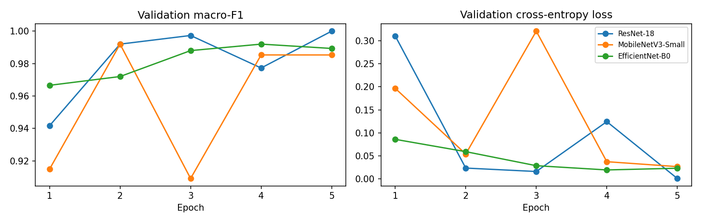
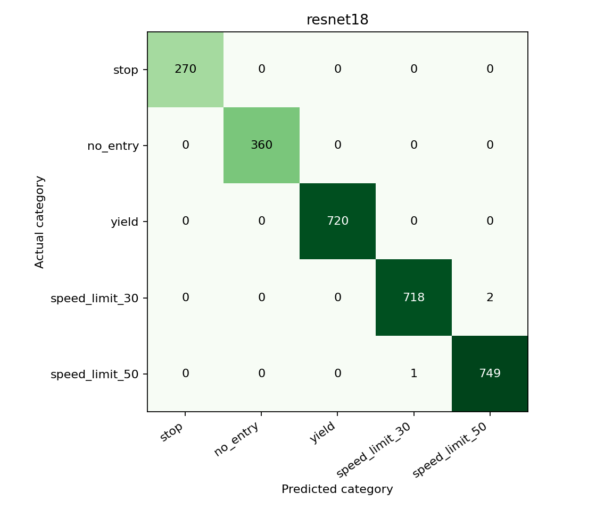
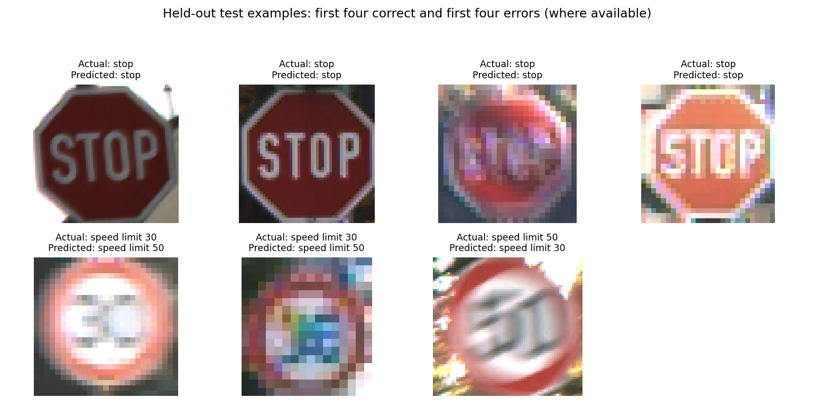

# Traffic Sign Classification Using Real Images

## Abstract

This project classifies real traffic-sign photographs into five categories using GTSRB. It compares pretrained ResNet-18, MobileNetV3-Small and EfficientNet-B0 under the same five-epoch budget. Training uses 2,500 images, validation uses 750 images and testing uses 2,820 images. Related training views are separated by sign track. One training track containing exact copies of test images is excluded. ResNet-18 is selected by validation macro-F1, not test accuracy. Its test accuracy is 99.89% and macro-F1 is 0.9992. An exported ONNX model is checked using actual inference. These results concern a five-class cropped-sign task, not full-scene detection or autonomous driving.

## 1. Introduction and Objective

Traffic signs give drivers instructions. Recognising a sign category is a useful computer-vision task with a clear input and output. The project was narrowed from a detector-plus-classifier demonstration to image classification so that the work could focus on real data, a fair model comparison and understandable evaluation. YOLO is not used in the new experiments; the old synthetic video is retained only as historical work. The research question is: which of three pretrained classifiers performs best under a small, shared training budget, and what are the costs in model size and inference time?

## 2. Methodology

### 2.1 Data, annotations and exploratory data analysis (EDA)

GTSRB is a public benchmark of real German traffic-sign photographs [1]. The downloaded final archives contain 39,209 training images and 12,630 test images across 43 classes. All 51,839 annotated images decoded successfully. No mismatches between image sizes and annotation sizes or invalid inclusive ROIs were found. Training categories contain 210 to 2,250 images, so the full dataset is imbalanced. Median training width and height are both 43 pixels. Small images and variable brightness make this more challenging than generated drawings.

The project uses Stop, No entry, Yield, Speed limit 30 and Speed limit 50. Actual traffic lights are not a GTSRB category, so the original category list has changed. Pixel hashing found eight exact image pairs shared by training and testing, all in stop-sign track 00023. All 30 training images in that track were excluded. This does not establish that every remaining image is independent: near-duplicate views remain within tracks.

| Category | Training | Validation | Test |
| --- | ---: | ---: | ---: |
| stop | 500 | 150 | 270 |
| no entry | 500 | 150 | 360 |
| yield | 500 | 150 | 720 |
| speed limit 30 | 500 | 150 | 720 |
| speed limit 50 | 500 | 150 | 750 |
| Total | 2,500 | 750 | 2,820 |

Sampling uses seed 42. Training contains 85 sign tracks and validation contains 25 different tracks. Tracks are assigned before selecting the image counts. Unused views and tracks are omitted. The official test examples for the five categories are all retained, and do not update weights or choose checkpoints. Test counts and exact duplicates were inspected during EDA; test predictions were not used to tune the models.

The complete EDA, including the class-distribution and image-property charts and real-image gallery, is available in [the EDA report](../gtsrb_eda/README.md).

### 2.2 Preprocessing and classification

Annotated rectangles provide the sign crops; no detector is required. ROI maximum coordinates are converted from inclusive image coordinates to exclusive crop coordinates. Crops are resized to 128 by 128 pixels and normalised using ImageNet mean and standard deviation. This input size limits CPU computation relative to 224-pixel inputs; different resolutions were not compared. Training adds colour jitter and rotations up to eight degrees. Validation and testing use fixed preprocessing. Horizontal flips are excluded because they can reverse digits or sign meanings. Upsampling a small image does not restore lost detail.

Each classifier starts with torchvision ImageNet-pretrained weights [2]. Its final output layer is replaced by a five-score layer. All parameters are fine-tuned, rather than freezing the feature extractor. ResNet-18 provides a familiar baseline; MobileNetV3-Small tests a smaller architecture; EfficientNet-B0 provides a further compact alternative. The same AdamW learning rate (0.0003), weight decay (0.0001), batch size (16), five epochs and seed (42) are used for each model. Cross-entropy measures training error. The highest validation macro-F1 checkpoint is retained. Shared settings provide a controlled comparison, but are not guaranteed to be optimal for every architecture.

### 2.3 Evaluation metrics and experimental design

Accuracy is the fraction of correct predictions. Precision describes how often a predicted category is correct; recall describes how many actual members of that category are found. F1 combines precision and recall: F1 = 2PR/(P+R), using zero when the denominator is zero. Macro-F1 averages the five class F1 scores with equal weight [3]. It is the primary selection metric because the test categories have unequal sizes. A confusion matrix shows which categories are confused: rows are actual categories and columns are predictions. These are classification metrics; detector mAP is not applicable to this revised task.

There are three neural-network training experiments, one per architecture, and one seed per experiment. The model is selected by highest validation macro-F1, with lower measured CPU latency breaking an exact tie. Test results are presented for all three fixed experiments, but are not the selection rule. A simple most-frequent-training-label baseline always predicts no entry: accuracy 12.77% and macro-F1 0.0453. The balanced training set has a tie between all five labels, resolved deterministically by scikit-learn's label ordering. No test labels choose the baseline's prediction. This constant baseline does not examine image pixels.

## 3. Experiments and Results

### 3.1 Classifier comparison

| Model | Validation Macro-F1 | Test Accuracy | Macro Precision | Macro Recall | Macro-F1 |
| --- | ---: | ---: | ---: | ---: | ---: |
| ResNet-18 | 1.0000 | 99.89% | 0.9992 | 0.9992 | 0.9992 |
| MobileNetV3-Small | 0.9920 | 95.04% | 0.9582 | 0.9588 | 0.9581 |
| EfficientNet-B0 | 0.9920 | 99.47% | 0.9960 | 0.9945 | 0.9952 |

### 3.2 Class-level results and error analysis

The validation-selected model is **ResNet-18**. It makes 2,817 correct predictions and 3 errors on 2,820 held-out test crops. The table below gives class-level results, so a high overall score cannot hide a weaker category.

| Category | Precision | Recall | F1 | Test Images |
| --- | ---: | ---: | ---: | ---: |
| stop | 1.0000 | 1.0000 | 1.0000 | 270 |
| no entry | 1.0000 | 1.0000 | 1.0000 | 360 |
| yield | 1.0000 | 1.0000 | 1.0000 | 720 |
| speed limit 30 | 0.9986 | 0.9972 | 0.9979 | 720 |
| speed limit 50 | 0.9973 | 0.9987 | 0.9980 | 750 |

Examples are the first four correct predictions and first four errors in the saved test ordering, when available. This is an error-inspection display, not a representative random sample. Every selected-model test prediction and source image path is saved in selected_test_predictions.csv. A photograph can be correctly classified while another small, dark or visually similar sign is misclassified. The confusion matrix and actual images should be used together; visual difficulty alone does not prove the cause of a particular error.

### 3.3 Timing, export and verification

| Model | Parameters (Millions) | PyTorch Forward (ms/image) | Training Time (minutes) |
| --- | ---: | ---: | ---: |
| ResNet-18 | 11.179 | 6.91 | 7.23 |
| MobileNetV3-Small | 1.523 | 27.75 | 8.89 |
| EfficientNet-B0 | 4.014 | 79.30 | 35.36 |

Training time includes subprocess startup and checkpoint writing. PyTorch latency uses one image, ten warm-ups and 30 repeated forward passes on CPU with two threads. It excludes image reading, cropping and normalisation. Hardware: macOS-26.6.2-arm64-arm-64bit. These measurements do not establish real-road video speed. Parameter count is not the same as training-checkpoint file size, which can include optimizer state. Smaller parameter counts do not guarantee lower measured CPU latency: different operators and their hardware implementations can change the ranking.

ONNX is a model format, not an additional classifier. The selected model was exported, checked structurally and run using ONNX Runtime. On the first 32 test images, maximum absolute PyTorch-versus-ONNX logit difference was 0.00000954, within the stated numerical tolerance. Both exported versions were then evaluated on all 2,820 test crops.

| ONNX Variant | File Size (MB) | Test Accuracy | Macro-F1 | Mean Forward (ms/image) |
| --- | ---: | ---: | ---: | ---: |
| float32 | 44.71 | 99.89% | 0.9992 | 9.56 |
| dense_int8 | 44.71 | 99.89% | 0.9992 | 8.14 |

The INT8 experiment dynamically quantises dense MatMul/Gemm weights only; convolution layers remain float32. It is not full-model INT8. ONNX timings use CPU, two threads, ten warm-ups and 50 repetitions, excluding preprocessing. These measurements should not be assumed equivalent to PyTorch timing. The float32 model remains the default, avoiding a deployment decision based only on file size or the test set.

## 4. Discussion and Reproducibility

Hydra holds the settings, Lightning organises training and TensorBoard stores curves. DVC records the downloaded archives, prepared split, comparison runs and model exports. Source archives have URL and SHA-256 provenance; the split CSV hash is stored with each experiment. The DVC pipeline replaces the earlier synthetic-data pipeline. A Dockerfile is supplied, but Docker is not installed on the measured machine, so a successful container build is not claimed. DVC storage is local unless a remote is configured; a GitHub clone alone does not contain the large dataset or model files. The project uses Lightning/Hydra organisation; a GitHub fork relationship with the originally recommended template has not been verified.

The practical difficulties were replacing generated data, finding suitable categories, handling small images, avoiding related views across splits, removing train/test duplicates, and comparing architectures under limited CPU resources. The CSV ROI headers also required matching the official field names. None of these is solved by simply downloading more images. Data checks and recorded settings are part of the experiment.

The project now has real-image training, three measured classifier experiments, class-level evaluation and a verified ONNX inference path. It is limited to five known German sign classes and has no unknown-category rejection. Predictions on full-road scenes, other countries, weather conditions or unseen camera systems are not established. One seed and five epochs do not establish a universal architecture ranking. Further work could repeat seeds, expand classes, measure a representative external test set and optimise training budgets. Full-scene detection would be a separate extension with detector-specific data and mAP evaluation.

## 5. Conclusion

The project compares three pretrained classifiers using real GTSRB photographs, a fixed track-separated development split and held-out testing. ResNet-18 is selected using validation macro-F1 and achieves 99.89% test accuracy and 0.9992 macro-F1. The main result is supported by per-class metrics, saved predictions and verified ONNX inference. The scope remains five-class cropped-sign classification; external testing and repeated runs are needed before making broader claims.

## Evidence Sources

The results are drawn from `report/gtsrb_results/comparison.json`, `dataset_summary.json`, `learning_curves.json`, `selected_test_predictions.csv`, and `onnx_verification.json`. The full EDA is recorded in `report/gtsrb_eda/`.

## References

[1] Stallkamp et al., The German Traffic Sign Recognition Benchmark: A multi-class classification competition, IJCNN, 2011. https://github.com/houbensebastian/GermanTrafficSignBenchmarks

[2] PyTorch torchvision model documentation and pretrained weights: https://docs.pytorch.org/vision/stable/models.html

[3] Scikit-learn classification metrics: https://scikit-learn.org/stable/modules/model_evaluation.html#classification-metrics
