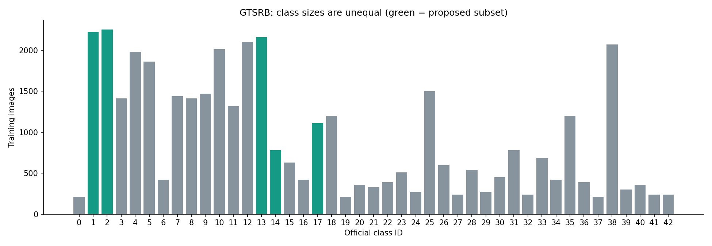
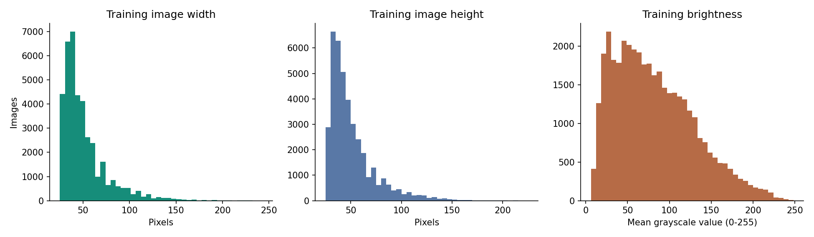
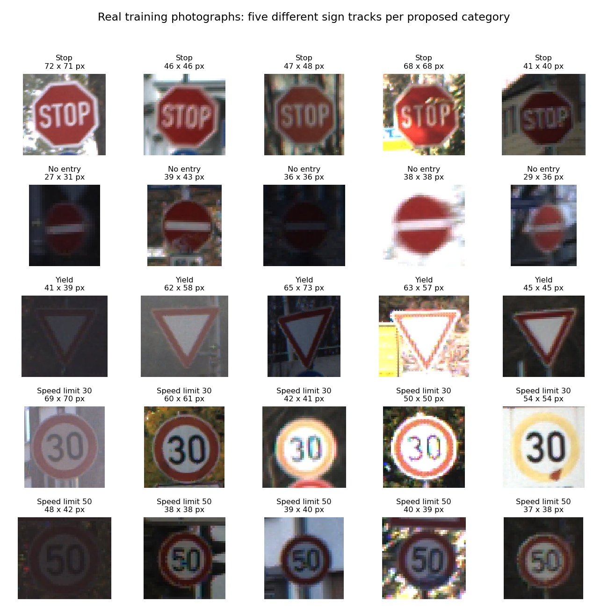

# GTSRB Exploratory Data Analysis

## Purpose
Inspect the real dataset before choosing final categories or training models. This analysis does not report model accuracy.

## Dataset Overview
- Source: [GTSRB dataset authors](https://github.com/houbensebastian/GermanTrafficSignBenchmarks).
- Locally verified: **51,839 images**, **39,209 official training images**, **12,630 official test images**, **43 classes**.
- Each image shows an individual traffic sign with some surrounding background. This supports classification, not a complete road-video detector.
- The official test set is preserved. Galleries and descriptive distributions below use training images only; test images are checked for integrity and exact duplicates.

## Class Distribution

Training class counts range from 210 to 2,250, a 10.71:1 ratio. Accuracy alone can hide poor performance on smaller classes. Report macro-F1, per-class precision and recall, and a confusion matrix alongside accuracy.

### Proposed Five-Class Subset (Not Yet Final)
| Category | Official Training Images | Official Test Images |
| --- | ---: | ---: |
| Stop | 780 | 270 |
| No entry | 1,110 | 360 |
| Yield | 2,160 | 720 |
| Speed limit 30 | 2,220 | 720 |
| Speed limit 50 | 2,250 | 750 |

Each proposed category has enough images for 500 training and 150 validation examples. These are image counts, not counts of independent physical signs. Traffic-light objects are not a GTSRB class, so this subset changes the original category list.

## Image Size and Appearance

Training widths: {'min': 25.0, 'median': 43.0, 'p95': 101.0, 'max': 243.0}. Training heights: {'min': 25.0, 'median': 43.0, 'p95': 98.0, 'max': 225.0}. Images need a consistent model input size. Enlarging tiny images does not recover missing detail. Resizing and normalization must be identical across classifier comparisons. Brightness is only a descriptive pixel statistic, not a label for lighting quality or a blur measurement.

The gallery uses real training photographs from different sign tracks, without synthetic sign generation or brightness enhancement. Enlargement is for viewing only. Small or dark signs can be harder to recognise. Similar speed-limit shapes make the printed number important. Avoid horizontal flipping because it can reverse numbers or sign meanings.

## Data Quality Checks
- All 51,839 annotated images were opened and decoded.
- Unreadable/missing images: 0.
- Image size versus annotation mismatches: 0.
- Out-of-bounds/invalid ROIs under an inclusive-maximum interpretation: 0. Detailed file lists are in summary.json; any flagged rows require review before cropping.
- Exact decoded-RGB duplicate groups: 8; extra copies: 8.
- Exact duplicate groups shared across official train/test: 8.
- Exact duplicate groups with conflicting category labels: 0.
- The affected files are listed in exact_duplicate_files.json. Before training, exclude affected training tracks from the development pool while keeping the official test set unchanged, then record the post-filtering counts. The proposed subset must be checked against this list too.
- This exact hash check does not detect near-duplicates or prove the labels are all correct.

## Leakage and Splitting
There are 1,307 training sign tracks. Images per track: {'min': 29.0, 'median': 30.0, 'p95': 30.0, 'max': 30.0}. A track contains related views of the same physical sign. Use disjoint tracks for training and validation, not an unrestricted random image split. Keep the official test set out of tuning and checkpoint selection. Do not claim that 500 images are 500 distinct signs.

## Decisions Before Training
1. Confirm a classification-only scope and final categories with the mentor.
2. Remove training tracks affected by exact train/test duplication before sampling. If the proposed subset is approved, verify the remaining counts and use the same 500 training and 150 validation images per class for each model, grouped by sign track; retain all official test examples of those classes.
3. Compare ResNet-18, MobileNetV3-Small and EfficientNet-B0 with consistent preprocessing, data split and training settings. Use validation macro-F1 for model selection, then report test metrics once the selection is fixed.
4. Report model size and measured inference latency alongside recognition quality. Model comparisons, exports and revised presentation results remain future work.
5. Existing synthetic checkpoints, scores and video are not results on this dataset.

## Reproduce
From the repository root: `python scripts/eda_gtsrb.py`. The script reads the downloaded archives without modifying the source images. Raw counts and checks are saved in class_counts.csv and summary.json. Archive provenance and SHA-256 hashes are recorded by the download script in download_manifest.json.

## Reference
J. Stallkamp, M. Schlipsing, J. Salmen, and C. Igel. The German Traffic Sign Recognition Benchmark: A multi-class classification competition. IEEE IJCNN, pp. 1453-1460, 2011.
