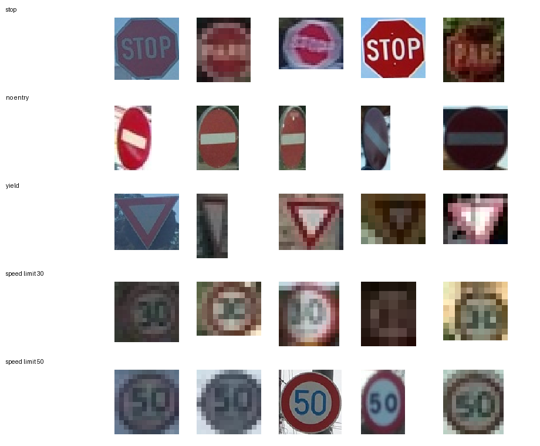
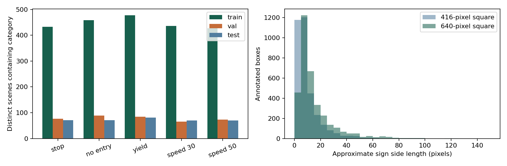

# EDA: Real Road Scenes from MTSD

## Data Source and Task

The source is the fully annotated Mapillary Traffic Sign Dataset v2, not generated drawings or pasted sign crops. The selected task locates and classifies five categories in road photographs. The authorised annotation archive matches its supplied MD5 checksum. Selected image files were checked using original ZIP member CRC32 and saved SHA256 digests; full image-archive MD5 checks are not claimed for range-downloaded subsets.

## Distinct Scene Counts

| Category | Training | Internal Validation | Held-out Local Test |
| --- | ---: | ---: | ---: |
| stop | 433 | 77 | 71 |
| no entry | 458 | 89 | 71 |
| yield | 478 | 84 | 81 |
| speed limit 30 | 436 | 65 | 70 |
| speed limit 50 | 427 | 73 | 70 |

There are 2018 training, 356 validation and 332 test scenes. A scene may contain multiple categories, so category counts do not sum to scene totals. All five target boxes in each retained photograph are included.

## Split and Duplicate Checks

Official training scenes supply internal training/validation. The selected official validation scenes are reserved for final local testing, not tuning; this is not a hidden official-test benchmark score. Exact decoded pixels and 64-bit full-scene difference hashes screen duplicates. Visually similar hashes stay in one internal group. Three training scenes in groups overlapping held-out data were excluded. These checks do not prove independent physical-sign identity without sequence metadata.

## Visual and Size Checks

These are the first five retained training crops per category, enlarged with nearest-neighbour sampling; enlargement does not add detail. Original crop sizes and source keys are recorded in example_provenance.json. Many signs occupy a small part of a large road scene. Blur, shadows, viewing angle, and international text variants are visible.

The global MTSD speed labels identify the displayed number and sign family. The application does not infer or convert national speed units from the shape alone; no claim is made that every global round 30/50 sign uses km/h. Both full-scene detection and annotated-crop classification use this Mapillary subset.

The sign-size chart uses a normalized-area proxy, not measured letterboxed dimensions. It motivates comparing detector resolutions, without predicting which will win. All 2706 prepared images decoded successfully. Mean grayscale brightness across thumbnails ranges from 46.1 to 218.6 on a 0-255 scale.

## Annotation Policy and Limitations

Panoramas are excluded, including wraparound rectangles that require a different representation. Scenes with selected target signs flagged ambiguous, occluded or out-of-frame are conservatively excluded. This simplifies the first experiment but makes its scope easier than unrestricted road video. Other sign categories remain in the photographs as background for the five-class task; they must not be relabelled as one of the targets. Selected scenes contain target signs, so the study does not estimate false alarms per hour on sign-free drives. No synthetic scenes or duplicate copies are used to inflate class counts.

## Source

[Official dataset access](https://www.mapillary.com/dataset/trafficsign) and [Ertler et al., ECCV 2020](https://www.ecva.net/papers/eccv_2020/papers_ECCV/papers/123680069.pdf). Preserve the distributed dataset licence and attribution. Temporary account-specific download links are private and are not published with the project.
