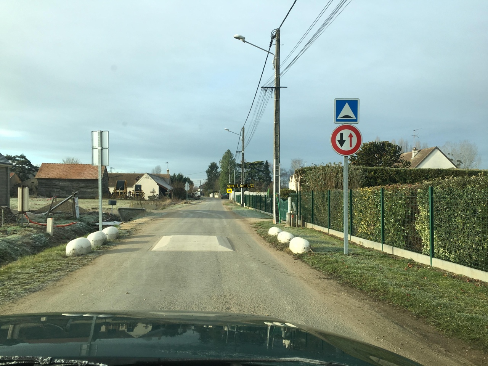
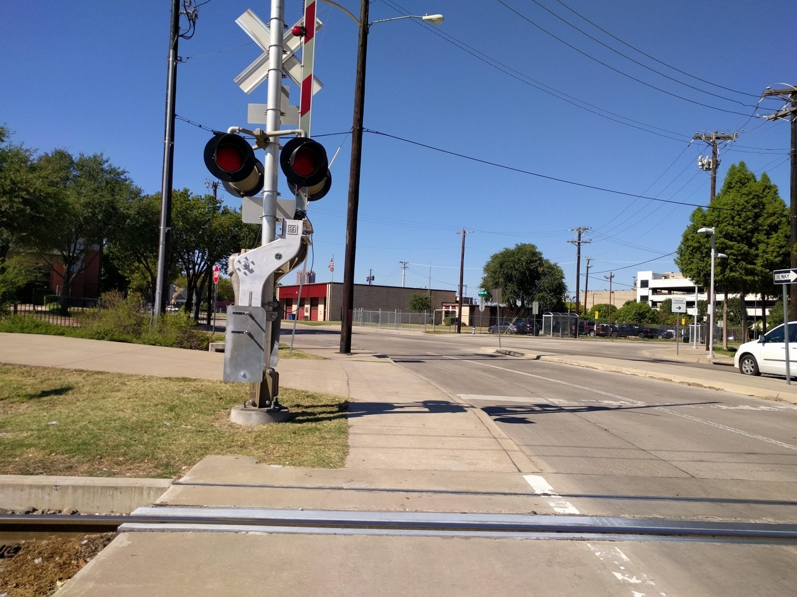

Traffic Sign Detection and Classification Using Real Road Images

Mannat Varshney | Graduation Capstone | Revised 26 October 2026

Abstract

This project develops a five-category traffic-sign inspection system using real photographs. A GTSRB crop study compares pretrained ResNet-18, MobileNetV3-Small and EfficientNet-B0. A separate MTSD road-scene study fine-tunes the lightweight YOLO11n detector and compares input resolutions using a fixed validation split. The prepared detection data contains 2,018 training, 356 validation and 332 held-out scenes. The selected crop classifier achieves 99.89% GTSRB test accuracy. The selected detector achieves 0.4839 mAP@0.50 and 0.3344 mAP@0.50:0.95 on the selected MTSD held-out subset. Actual ONNX inference is checked, not just file export. Crop accuracy, scene detection quality and processing speed are reported separately.

1. Introduction and Motivation

Traffic-sign inspection is a practical computer-vision task: a road photograph may contain a small, blurred or partly obscured sign among buildings, vehicles and other objects. The objective is to locate supported signs and label them as stop, no entry, yield, speed limit 30 or speed limit 50. The tool saves annotated images or video and a detection table. It is not a driving controller and does not decide whether a road is safe.

The project retains the existing Lightning/Hydra training structure and classifier comparisons, but adds a real full-scene detection task. Cropped-sign classification answers which category a supplied rectangle contains. Detection must also find the rectangle. GTSRB alone cannot establish full-road performance. MTSD supplies real street photographs and manually annotated boxes [1,2].

1.1 Research Questions

The experiments ask: which small classifier performs best under the same training budget; how detector input resolution changes validation detection quality; whether a separately trained crop classifier helps or hurts on detected global road-scene crops; and whether exported ONNX inference preserves the measured detector results. Model selection uses validation data, not final test scores.

1.2 Related Work and Project Contribution

GTSRB and GTSDB motivate the distinction between recognition and detection [1]. The MTSD authors study globally varied signs and explicitly provide full scenes with fine-grained labels [2]. DFG demonstrates traffic-sign inventory as an application [3]. This project uses those ideas for a bounded student implementation: a five-class detector, controlled crop baselines, an executable image/video interface, deployment verification and reproducible experiment records. Published paper scores are not reported as this project's results.

2. Methodology

2.1 Real Data, Annotations and EDA

GTSRB supplies 500 training and 150 validation crops per class, plus 2,820 official test crops in total. Training and validation use different sign tracks. Eight exact train/test pairs were found in one stop-sign training track; all 30 images in that track were removed before sampling. The three classifier experiments are unchanged by the new detection study.

For detection, the authorised MTSD v2 fully annotated release is used. Its annotation ZIP matches the supplied MD5. Original selected image members pass ZIP CRC32 and have recorded SHA256 digests. Range downloads retrieve only the selected images; full image-archive MD5 verification is not claimed. No signs are drawn or pasted into generated scenes.

<table><tr><td>Category</td><td>Train scenes</td><td>Val scenes</td><td>Test scenes</td><td>Train boxes</td></tr><tr><td>stop</td><td>433</td><td>77</td><td>71</td><td>498</td></tr><tr><td>no entry</td><td>458</td><td>89</td><td>71</td><td>546</td></tr><tr><td>yield</td><td>478</td><td>84</td><td>81</td><td>576</td></tr><tr><td>speed limit 30</td><td>436</td><td>65</td><td>70</td><td>478</td></tr><tr><td>speed limit 50</td><td>427</td><td>73</td><td>70</td><td>465</td></tr></table>

One scene can contain several boxes or categories, so category scene counts do not sum to total scenes. More than 400 distinct training scenes per class remain after validation is reserved; this is not 500 independent physical signs per class. Selected official validation scenes form the final local test; hidden test labels are unused. Global speed classes identify the posted number and sign family, not an inferred or converted national speed unit.

Figure 1. Actual MTSD training photograph. Yellow boxes mark only the five selected categories. Large nearby road-bump and oncoming-traffic-priority signs are annotated in the source but outside this task. These are ground-truth boxes, not detector predictions.

2.2 Split Protection and Exclusions

Exact decoded-pixel checks and 64-bit full-scene difference-hash components screen visually similar images. Three training scenes in components overlapping held-out data are removed. Internal training and validation are split by those groups. This screening does not prove physical-sign independence without sequence metadata. Panoramas and scenes with selected target signs flagged ambiguous, occluded or out-of-frame are excluded. The scope is therefore easier than unrestricted driving footage.

Following annotation review, all 2,706 prepared scenes and 3,433 target boxes were compared with the five exact g1 source labels and coordinates: 0 scene mismatches were found. Other source labels are background. This includes 19 related regulatory stop/speed variants and one complementary speed sign not merged in the recorded task. Thus the five names do not imply all international variants are covered. Broader coverage requires reviewed remapping and retraining. The audit verifies mapped-label retention, not completeness of the original annotations.

2.3 Models, Preprocessing and Training

The classifier study fine-tunes all parameters of three ImageNet-pretrained models for five epochs using 128-pixel RGB crops, ImageNet normalisation, AdamW, learning rate 0.0003, weight decay 0.0001, batch size 16 and seed 42. Training uses small rotations and colour jitter, without horizontal flipping. Checkpoints and the classifier architecture are selected by validation macro-F1.

The detector is YOLO11n with a new five-class output head, initialised from general pretrained weights. Initial runs compare 416 and 640 pixels for five epochs each, with batch size 8, AdamW, learning rate 0.001, weight decay 0.0005 and seed 42. The first ten backbone blocks are frozen to reduce CPU training cost. Flips, mosaic and copy-paste are disabled; small rotations, translations, scaling and colour changes are applied to real scenes. Preparation caps the longest image side at 1,280 pixels; training letterboxes images to the chosen input size.

An additional 15-epoch fine-tuning run starts from the selected 640-pixel checkpoint, with five frozen blocks and learning rate 0.0005. It uses Apple M1 MPS acceleration; initial runs use CPU. Training durations are not a controlled hardware-speed comparison. This is a validation-led extension, not another same-start architecture comparison.

Small objects are addressed using SAHI overlapping 640-pixel inference tiles, including a whole-image pass, 20% overlap and class-aware NMS at IoU 0.7. Whole versus tiled mode is selected on 356 internal validation scenes using mAP50:95. A confidence of 0.343 is selected by validation F1. Tiling changes inference, not training-image counts, and cannot reconstruct detail lost in the 1,280-pixel preparation.

2.4 Metrics and Their Selection

Accuracy is the fraction of correctly classified crops. Precision measures how often a predicted category is correct; recall measures how many actual members are found. F1 = 2PR/(P+R). Macro-F1 weights categories equally and is useful when test supports differ. It selects the classifier. A confusion matrix shows the individual category errors; it is not itself an accuracy score.

Detector IoU is intersection area divided by union area of a predicted and true rectangle. mAP@0.50 averages class average precision with IoU at least 0.50. mAP@0.50:0.95 averages ten IoU thresholds and tests tighter localisation, so it selects detector settings. These metrics consider missed objects and false detections; crop accuracy does not. Fixed-threshold precision, recall and F1 additionally describe a particular deployed operating point.

3. Experiments and Results

3.1 GTSRB Classifier Comparison

<table><tr><td>Model</td><td>Val F1</td><td>Test acc.</td><td>Macro P</td><td>Macro R</td><td>Macro F1</td></tr><tr><td>ResNet-18</td><td>1.0000</td><td>99.89%</td><td>0.9992</td><td>0.9992</td><td>0.9992</td></tr><tr><td>MobileNetV3-Small</td><td>0.9920</td><td>95.04%</td><td>0.9582</td><td>0.9588</td><td>0.9581</td></tr><tr><td>EfficientNet-B0</td><td>0.9920</td><td>99.47%</td><td>0.9960</td><td>0.9945</td><td>0.9952</td></tr></table>

ResNet-18 is selected by validation, not test accuracy. It correctly predicts 2,817 of 2,820 test crops. Its three errors confuse the two speed-limit categories. Smaller parameter counts do not automatically imply faster CPU execution: measured crop forward times are retained in the classifier results. These figures are not road-scene accuracy.

3.2 Controlled Detector Comparison

<table><tr><td>Run</td><td>Val mAP50</td><td>Val mAP50:95</td><td>Train min</td></tr><tr><td>yolo11n_416</td><td>0.1640</td><td>0.1049</td><td>11.5</td></tr><tr><td>yolo11n_640</td><td>0.2885</td><td>0.1943</td><td>24.6</td></tr><tr><td>yolo11n_640_finetuned</td><td>0.3398</td><td>0.2302</td><td>36.9</td></tr></table>

Selected before test evaluation: yolo11n_640_finetuned. The two initial resolution runs share a budget and split. The extra fine-tune has a different initialization and budget. These are settings of one detector architecture, not three architectures. Each is a single-seed run.

<table><tr><td>Inference mode</td><td>Val mAP50</td><td>Val mAP50:95</td><td>Mean ms/scene</td></tr><tr><td>whole</td><td>0.3209</td><td>0.2198</td><td>51.5</td></tr><tr><td>sliced</td><td>0.4859</td><td>0.3379</td><td>410.5</td></tr></table>

The same selected checkpoint and validation scenes are used above with fixed-square preprocessing. Tiling improves aggregate validation mAP50:95 from 0.2198 to 0.3379, at approximately eight times the image-read/detector processing cost. Training-validator figures above use its validation preprocessing and should not be mistaken for this controlled inference-mode comparison.

3.3 Held-out Road-Scene Results

On 332 selected held-out scenes, detector mAP@0.50 is 0.4839 and mAP@0.50:0.95 is 0.3344. Precision and recall at the maximum-F1 curve point are 0.6031 and 0.4653; they are not the same as the fixed-confidence numbers below.

<table><tr><td>Category</td><td>AP50</td><td>AP50:95</td></tr><tr><td>stop</td><td>0.6767</td><td>0.4849</td></tr><tr><td>no entry</td><td>0.3914</td><td>0.2415</td></tr><tr><td>yield</td><td>0.5804</td><td>0.3830</td></tr><tr><td>speed limit 30</td><td>0.3609</td><td>0.2608</td></tr><tr><td>speed limit 50</td><td>0.4102</td><td>0.3017</td></tr></table>

3.4 Detector Labels versus Crop Refinement

<table><tr><td>Pipeline</td><td>Precision</td><td>Recall</td><td>F1</td><td>TP / FP / FN</td></tr><tr><td>Detector only</td><td>0.5811</td><td>0.4635</td><td>0.5157</td><td>197 / 142 / 228</td></tr><tr><td>Detector + crop model</td><td>0.6519</td><td>0.5200</td><td>0.5785</td><td>221 / 118 / 204</td></tr></table>

These counts use validation-selected confidence 0.343, IoU 0.50 and one-to-one same-class matches. GTSRB-trained ResNet ONNX refinement changes labels, not boxes, and cannot recover missed signs. It improves F1 on this held-out subset; the default remains the predeclared detector-only pipeline rather than switching after inspecting test scores. On the 229 class-agnostically matched boxes, crop accuracy is 96.51%; missed signs are excluded from that conditional metric.

Figure 2. Actual processed held-out road scene. The demo selects early examples by source category, not correctness, and also contains missed or incorrect detections. A gallery video of these real still photographs is not continuous road footage.

3.5 Processing Time

The warm PyTorch-detector-plus-ONNX-classifier pipeline averages 422.98 ms per scene, with median 420.31 ms and 95th percentile 447.69 ms. Timing includes image reading, detector preprocessing/inference/NMS and crop inference; loading models, scoring and output encoding are excluded. Measurements use the recorded macOS CPU system, two PyTorch threads and two classifier ONNX threads. This is not a continuous-video real-time guarantee.

4. Deployment, Reproducibility and Discussion

4.1 ONNX and Optimisation

ONNX is an exported model format, not a third neural architecture. The selected detector is exported with opset 17, fixed batch size 1 and 640-pixel input. ONNX model structure checks pass. Raw outputs on three real test images are compared numerically with PyTorch; the largest absolute difference is 0.000793. Preprocessing and non-maximum suppression are still provided by the application, not embedded in the graph.

Actual exported-detector inference is also evaluated on all 332 local test scenes: ONNX mAP50 is 0.4839, compared with 0.4839 for PyTorch. Framework/runtime timings are reported separately because thread defaults and implementations differ. The existing classifier experiment additionally compares float32 with dense-layer-only dynamic INT8; convolution layers remain float32. This is not full-detector quantisation or pruning, and reduced precision is not assumed to be faster.

4.2 Versioning and Execution

The project uses Git for code, DVC for data/model versions, TensorBoard for training curves, Hydra for classifier configuration, and Lightning for the classifier loop. Detection settings are in pipelines/detection/. The image/video command writes annotated media, CSV detections and measured timing. Dataset terms apply separately from code; temporary authorised download links are not committed. Restoring licensed data requires authorised artifact access or regeneration from an authorised download.

A Docker recipe and automated build/test workflow define the execution environment. Local Docker execution is not verified because Docker is unavailable on this machine; CI build status must be checked after upload. The final submission repository is a verified fork of Vladimir-125/lightning-hydra-template, with the upstream MIT notice and initial template commit preserved. Remote artifact access must be documented separately from the source repository.

4.3 Difficulties and Limits

The main difficulties were acquiring real full scenes, protecting splits, preserving label meaning and finding small signs. The mentor identified apparently missing labels and tiny targets. Source-level comparison showed the nearby omitted signs were unsupported categories, while the two speed-50 targets shrink to about 14 pixels at preparation and 7 at whole-scene input. Numbered source views fix report readability; tiled inference measurably improves aggregate detection but does not solve every tiny sign. Near-perfect crop accuracy does not imply reliable scene detection.

The study uses selected positive scenes, excluded difficult targets, one seed per initial run and a modest CPU budget. Difference hashes do not establish independent physical signs. Unsupported sign categories are not detected intentionally, and false alarms on sign-free journeys remain unmeasured. The real-image gallery is qualitative evidence, not a labelled real-video benchmark. Improvements include more training, broader difficult-scene coverage, repeated seeds and independent real-road video evaluation.

5. Conclusion

The project now uses real cropped and full-scene data, compares three classifiers and detector settings, saves actual annotated output, and verifies exported detector inference. The principal results are 99.89% GTSRB crop accuracy and 0.4839 held-out local scene mAP50. They answer different questions and must not be combined into one percentage. The implementation supports inspection and further experiments; it does not establish autonomous-driving reliability.

References and Evidence

[1] Stallkamp et al., GTSRB, IJCNN 2011; Houben et al., GTSDB, IJCNN 2013. github.com/houbensebastian/GermanTrafficSignBenchmarks. [2] Ertler et al., The Mapillary Traffic Sign Dataset for Detection and Classification on a Global Scale, ECCV 2020. mapillary.com/dataset/trafficsign. [3] Tabernik and Skocaj, IEEE T-ITS 2019. vicos.si/resources/dfg/. [4] Akyon et al., Slicing Aided Hyper Inference, ICIP 2022. github.com/obss/sahi. Evidence: report/gtsrb_results/, mtsd_results/, mtsd_onnx_results/, mtsd_eda/, mtsd_annotation_review/.